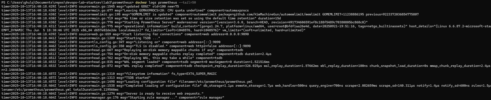
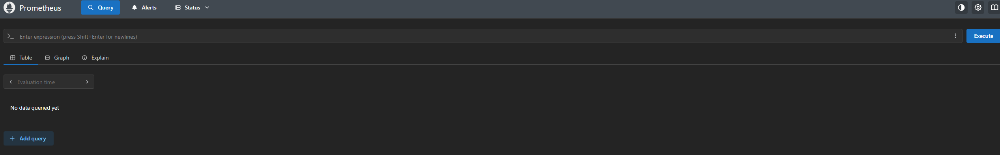
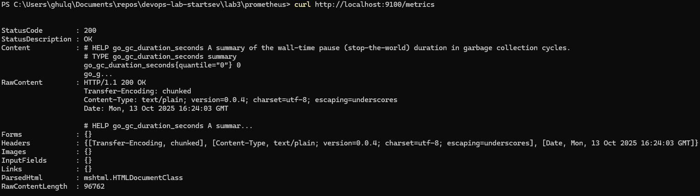
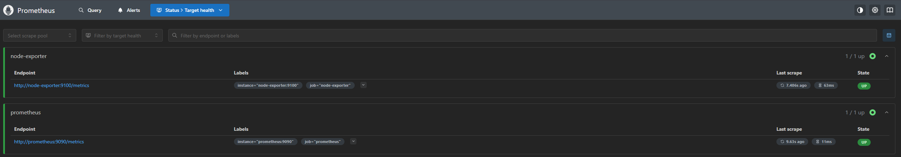
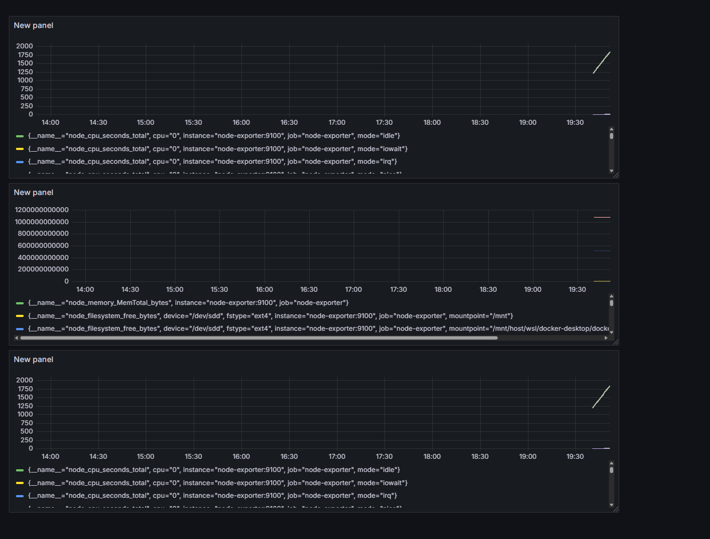
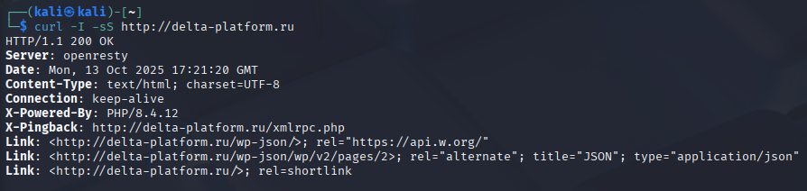
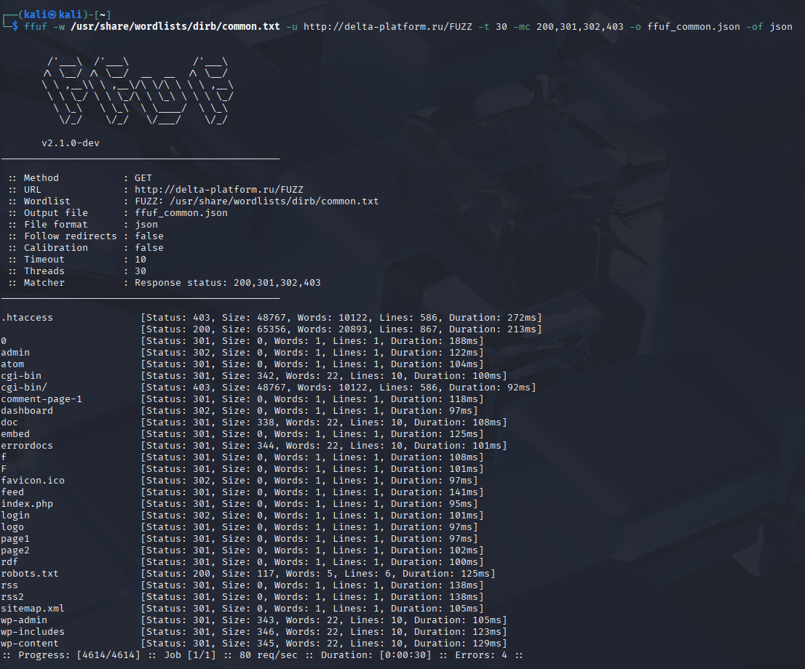

University: ITMO University  
Faculty: FTMI  
Course: Introduction in Web Technologies  
Year: 2025/2026  
Group: U4225  
Author: Startsev Daniil Vitalevich  
Lab: Lab 3 — Мониторинг с Prometheus и Grafana
Date of create: 13.10.2025  

---

## Цели и задачи  
Научиться настраивать локальную систему мониторинга, собирать метрики с помощью Prometheus и создавать дашборды в Grafana для визуализации данных.

## Ход работы

### Шаг 1. Создание конфигурации и запуск Prometheus:
Запуск Prometheus

 ---

### Шаг 2. Запуск Node Exporter:

### Шаг 3. Запуск Grafana и создание Dashboard
 Создал Dashboard и добавил необходимые метрики.

 
 ---
 

---

# Отчёт по тестированию — delta-platform.ru

## Область и ограничения
- Цель: https://delta-platform.ru  
- Запрещено: DDoS, подбор паролей, эксплуатация уязвимостей, скачивание конфиденциальных данных.  
- Инструменты: curl, ffuf, jq, (Burp/ZAP).

---

## Описание
Я выбрал цель delta-platform.ru и провёл этичный разведывательный тест: 
- одиночными curl-запросами проверил варианты path-traversal (закодированный ..%2F... → 400, ../../../../etc/passwd → 404, ещё один запрос вернул 301 с Location, содержащим traversal)
- снял HTTP-заголовки (Server: openresty, X-Powered-By: PHP/8.4.12, заметны WP-пути)
- затем прогнал перебор директорий через ffuf с Seclists (common/medium) 
- в результате выявлены стандартные WP-пути (robots.txt, sitemap.xml, wp-admin, wp-content), .htaccess отвечает 403

---

---

## Path traversal (curl):

..%2F..%2F..%2F..%2Fetc%2Fpasswd → 400 Bad Request — сервер отверг закодированный вариант.

../../../../etc/passwd → 404 Not Found — сервер не вернул файл (нет доступа / нормализовал путь).

Ещё один вариант вернул 301 Moved Permanently с Location: http://delta-platform.ru/../../../../etc/passwd. То есть сервер (или WordPress/nginx) сделал редирект на URL с тем же traversal-фрагментом, но не отдал содержимое файла.

### Вывод: 
прямого удачного path-traversal-а не видно — нет HTTP 200 с телом, похожим на /etc/passwd. Поведение редиректа с отражением путя может указывать на некорректную нормализацию/канонизацию URL, но само по себе это не экзплойт — пока низкий риск, но стоит зафиксировать и проверить аккуратно.

## HTTP-заголовки (curl -I):

Server: openresty (nginx variant), X-Powered-By: PHP/8.4.12, ссылки на wp-json — чёткая индикация WordPress.

Это даёт направление для дальнейшего анализа (wp-json, wp-admin, стандартные WP-пути).

## ffuf — перебор директорий (common.txt):

Найдено много стандартных WP-путей: robots.txt (200), sitemap.xml (301/302), wp-admin, wp-includes, wp-content (301/302/343/345 размер/статус разные).

.htaccess — 403 (файл существует, но доступ запрещён) — нормально, но указывает, что файл есть в корне.

cgi-bin — 403 (часто сервер возвращает 403 для запретов).

Множество 301-редиректов (WordPress/перелокации): это типично и говорит, что сайт использует rewrite/pretty URLs и много редиректов на «чистые» пути.

index.php и корень возвращают 200 с большим размером — это нормальные страницы.

## Вывод по ffuf:
 Обнаружены полезные ресурсы для картирования (robots, sitemap, wp-admin и т.д.), но очевидных конфигов (например .env с 200) или бэкапов, видимых в этом быстром прогоне, нет.